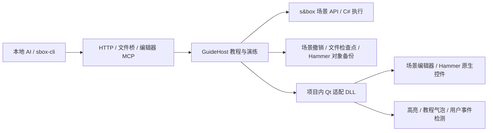

# AI Guide 编辑器插件使用手册

插件源码、内置教程、测试、通用手册统一由现有 RailgunHamster/AIGuide Git 仓库的 `Sbox/` 管理。游戏项目的 `Libraries/AIGuide/` 是 Verso 管理的标准 Library 快照，不单独作为游戏文件提交 Lore；项目教程位于 `Config/AIGuide/Recipes/`，继续由项目版本控制管理。

AI Guide 让本地 AI 读取编辑器界面、操作控件、标出按钮，并把操作整理成玩家自己完成的分步教程。它运行在目标项目的 s&box 编辑器中，覆盖场景编辑器与同一进程内的 Hammer 原生 Qt 界面。

这是根据 Godot 模块的功能重新实现的 s&box 插件。Godot 的场景节点、EditorInterface、GDScript、引擎补丁没有直接搬过来。AIDebug 作为独立标准 Library 可选接入，AI Guide 可转发已激活的调试服务。

## 1. 安装、启动与配置

团队项目将原 Git 仓库的 `Sbox/` 通过 Verso 依赖映射到 `Libraries/AIGuide/`，其中 `.sbproj` 声明标准 Library。成员获取完整更新后打开编辑器即可使用，无需脚本、IDE 或手动设置。s&box 自动编译 Library 自己的 `Editor/`。复制安装器和编辑器内自更新已移除。

原生适配 DLL 位于 Library 内的 `Editor/AIGuide/Native/`，与 `BuildInfo.json` 一同提供。加载时检查 DLL 哈希及 Qt 模块组合，运行缓存写主项目 `.ai_guide/`。兼容 Steam 官方 `26.10.27c`、LTN 当前构建和已验证的 railgunhamster 旧 Qt；缺少便利成员的旧 SDK 通过能力适配。

项目教程仍位于 `Config/AIGuide/Recipes/`，同名教程覆盖内置示例。旧项目部署目录可由主项目自己的 `Metadata.Compiler.IgnoreFolders` 排除；Library 使用独立编译配置。更新前保存并关闭编辑器，由 Verso 完成依赖获取后再打开，避免进程驻留原生模块继续使用旧版本。

进入 `编辑器顶部 AI Guide → 教程与状态` 可查看 MCP 地址、启动已保存教程、停止引导。另有“复制 MCP 地址”和“停止引导”菜单。

默认本地地址为 `http://127.0.0.1:7660/mcp`。本机可创建 `.ai_guide/config.json`：

```json
{
  "enabled": true,
  "port": 7660,
  "token": ""
}
```

端口被其他编辑器占用时，在另一项目选择不同端口。修改配置后调用 `ai_guide_reload` 或重启编辑器。`token` 非空时，HTTP 请求需带 `Authorization: Bearer <token>`。服务仅监听 IPv4 回环地址，不是远程公网服务。

`.ai_guide/session.json` 提供当前进程号、项目和地址。`.ai_guide/`、`.ai_guide_bridge/` 是本机数据，不发布到 Lore。C# 修改由引擎自动热加载；更新原生 DLL 必须重启编辑器。

## 2. 三种调用入口

### 2.1 使用已有 sbox-cli

在项目目录运行所用引擎附带的 `sbox-cli.exe`，先用 `--list` 查当前编辑器进程，然后显式连接：

```powershell
$cli = 'C:/path/to/sbox/bin/managed/sbox-cli.exe'
& $cli --list
& $cli --connect <PID> --call aiguide_status
& $cli --connect <PID> --call aiguide_tools
& $cli --connect <PID> --call aiguide_call '{"tool":"ui_find","args":{"text":"File","kind":"menu"}}'
```

`aiguide_tools` 返回完整 17 项工具的 JSON Schema；`aiguide_call` 包装其中任意一项。原生模态窗口阻塞引擎主循环时，优先使用下面的独立 HTTP 入口。

可选的 AIDebug 是另一个仓库和插件。项目安装它之后，`aiguide_tools` 和 HTTP 工具列表会增加 19 个 `ai_debug_*` schema；使用前需从 AI Debug 菜单或其可信本地加载脚本激活调试模块。AI Guide 本身不安装、不加载、不激活调试程序集。`.ai_debug/config.json` 管理调试设置；旧 `debug_enabled` 不再生效。详见 [AIDebug s&box 手册](https://github.com/RailgunHamster/AIDebug/tree/main/Sbox)。

### 2.2 HTTP MCP

把支持 Streamable HTTP 的本地 MCP 客户端指向上述 `/mcp` 地址。协议使用无会话的 JSON-RPC POST；教程进度通过 `guide_status` 查询。

```powershell
$request = @{
  jsonrpc = '2.0'; id = 1; method = 'tools/call'
  params = @{ name = 'ui_find'; arguments = @{ text = 'File'; kind = 'menu' } }
}
Invoke-RestMethod 'http://127.0.0.1:7660/mcp' -Method Post `
  -ContentType 'application/json; charset=utf-8' `
  -Body ([Text.Encoding]::UTF8.GetBytes(($request | ConvertTo-Json -Depth 20)))
```

普通结果在 `result.content` 的文本块中，内容是 JSON；工具错误带 `isError:true`。截图还返回 PNG 图片块。`initialize`、`ping`、`tools/list`、`tools/call` 均可直接调用。

### 2.3 文件桥

创建 `.ai_guide_bridge/in`，将相同 JSON-RPC 请求先写为临时文件，再原子重命名为唯一的 `*.json`。插件将答复写入同名 `out/*.json`，处理过的输入移到 `processed/`。用唯一文件名避免请求冲突。单个请求上限 8 MiB。

## 3. 工具对应表

| 工具 | 用途 | 常用参数 |
|---|---|---|
| `editor_state` | 项目、场景、选择、检查器、Hammer、窗口和教程状态 | 无 |
| `scene_tree` | 当前编辑场景的对象及组件树 | `root`：GUID/精确名称；`depth`；`include_properties` |
| `ui_snapshot` | 原生控件与虚拟条目的结构化快照 | `root`、`visible_only`、`max_nodes`、`max_items` |
| `ui_find` | 搜索控件、树条目、标签和菜单 | `text`、`class`、`name`、`kind`、`under`、`exact` |
| `ui_describe` | 矩形、locator、可见性及隐藏原因 | `target` |
| `ui_act` | 点击、输入、滚动、拖动、快捷键等 | `action`、`target`，按动作附加参数 |
| `ui_highlight` | 多目标编号与说明 | `targets`、`text`、`duration_ms`、`clear` |
| `ui_guide` | 开始交互教程，替换当前教程 | `title`、`steps`、`dim`、`auto_scroll` |
| `guide_status` | 当前步、等待状态与事件记录 | 无 |
| `guide_control` | 前后步、演示、停止与重来 | `action`；重来可指定 `rollback` |
| `editor_screenshot` | 窗口 PNG 或目标周围裁图 | `window` 或 `target`、`margin`、`max_width` |
| `editor_exec` | 受信任的编辑器 C# 语义操作 | `code`、`timeout_ms` |
| `rehearsal_start` | 开始演练与记录 | `title` |
| `rehearsal_stop` | 回退、生成并保存教程 | `rollback`、`save_as`、`texts`、`start_guide` |
| `recipe_list` | 列出项目教程 | 无 |
| `recipe_play` | 启动已保存教程 | `name`，可覆盖 `title`、`texts`、`dim` |
| `ai_guide_reload` | 清除引导并重启服务 | 无 |

## 4. 定位与实际操作

先 `ui_snapshot`/`ui_find`，再使用结果中的 `ref` 或 `locator`。`ref` 是本次控件实例的标识；`/qt/...` locator 记录控件祖先、对象名、同类兄弟顺序及虚拟条目身份，可用于教程重放。不要手写编码后的 locator。编辑器大改布局或重排同名控件后应重新发现目标。

文本搜索默认大小写不敏感，`exact:true` 为大小写敏感的完全匹配。多个结果时操作会拒绝猜测。用 `kind` 和 `under` 缩小范围，或直接传唯一 `ref`。

`kind` 包括 `control`、`tree`（含列表/表格项目）、`tab`、`menu`、`graphic`。Qt 树条目、标签和菜单是虚拟元素，不是独立 QWidget。自定义 GPU 画布只能发现其窗口/视口，不能自动理解画出来的模型、面片或任意节点图；这些语义操作要使用 s&box/Hammer API。

隐藏原因包括未激活标签、折叠的父项、祖先隐藏、被裁剪/滚出视野、模态窗口阻挡。查找隐藏目标时传 `visible_only:false`。

`ui_act.action` 支持：`click`、`double_click`、`right_click`、`middle_click`、`hover`、`scroll`、`drag`、`type`、`paste`、`key`、`focus`。它向 Qt 发送输入事件，不移动系统鼠标。

```json
{"action":"paste","target":"e12","text":"月球基地"}
{"action":"key","target":"e12","keys":"Ctrl+S"}
{"action":"scroll","target":"e20","amount":3}
{"action":"drag","target":"e20","to":"e25","modifiers":{"shift":true}}
```

`paste` 使用剪贴板、Ctrl+A/Ctrl+V 替换文本；`type` 逐字插入。快捷键支持字母、数字、F1–F35、方向键、Enter/Tab/Escape、Home/End/PageUp/PageDown 等，可组合 Ctrl/Shift/Alt/Meta。`show:true` 先显示约 350 ms 的目标高亮再操作。

快照中的矩形采用屏幕坐标、Qt 逻辑像素。`ui_act` 的 `x/y` 是所选窗口客户区坐标；拖动 `to:{x,y}` 也以窗口客户区为准。优先用目标定位，减少对分辨率的依赖。

返回的 `delivery.status` 区分排队、正在派发、完成与失败。打开阻塞式对话框的点击可保持 `delivering`，直到对话框关闭。事件派发成功仍需读取实际控件或应用状态验证结果。

## 5. 教程与演练

简单教程：

```json
{
  "title":"找到保存入口",
  "dim":true,
  "steps":[
    {"target":{"text":"File","kind":"menu","exact":true},"text":"打开 File 菜单"},
    {"target":{"text":"Save","kind":"menu","exact":true},"text":"选择保存","until":"manual"}
  ]
}
```

每步有编号、高亮、说明，以及上一步/下一步/定位/从头开始/退出按钮。教程面板显示准备中、启动结果或失败原因。开始、自动推进、上一步或下一步时，自动呈现目标所在窗口；等待中的目标出现后也会定位。窗口只在这些时机激活，不会每帧抢焦点；操作中切到其他窗口可用“定位”返回。目标被模态窗口阻挡时先等待该窗口处理。

未找到目标时等待；可选 `fallback` 查询用于原 locator 失效后的定位。`under` 指定的父窗口不存在时不会搜索其他窗口。Qt 树条目和普通滚动区域最多尝试三次滚动定位，不会自动展开折叠树或切换隐藏标签。原生材质行可用 `class:CQTextureControl,label:Color` 等语义定位，再在其下查找 `QLineEdit`。

顶层 `activate_window` 默认 true，可关闭自动切窗。`open_assets` 是可选的项目资源路径列表，如 `maps/level1.vmap`，在捕获检查点后通过编辑器打开。每步 `project_path` 是主项目相对文件路径，进入时把当前同事机器上的完整路径放入剪贴板；普通 `clipboard` 用于贴图路径等固定文本。共享教程不要保存作者盘符、用户名或临时 `eN` 引用。

教程与演练期间临时使用 Qt 风格文件对话框，以便高亮文件名、保存等控件；停止或完成后恢复之前的对话框设置。

默认由用户点击目标完成。AI 的合成点击不会冒充用户点击；演示用 `guide_control:{action:"do_step"}`，动作可在步骤的 `action` 中指定。

完成条件：

- `"click"`、`"manual"`。
- `{"visible":target}`、`{"exists":target}`。
- `{"text_contains":{"target":target,"text":"内容"}}`。
- `{"text_equals":{"target":target,"text":"内容","committed":true}}`、`{"number_equals":{"target":target,"value":0.7,"committed":true}}`。`committed` 要求在本步内按 Enter 或离开输入框后再判定，避免输入尚未提交便跳步。
- `{"tooltip_contains":{"target":target,"text":"#FFFFFF"}}`，用于颜色预览等提供结果提示的控件。
- `{"context":{"path":"hammer.selection_mode","equals":"Faces"}}`，按实际编辑器状态完成。
- `{"key":"Ctrl+S"}`，用户键盘事件。
- `{"selected":"对象 GUID 或名称"}`、`{"inspecting":"GUID、名称或类型全名"}`。
- `{"main_screen":"场景名称"}` 或 `"Hammer"`。
- `{"file_saved":{"path":"Assets/materials/practice.vmat","ext":"vmat","contains":"可选内容"}}`，检测进入该步骤之后写入的文件。优先指定准确项目路径；省略路径时进行有数量、深度和大小限制的扫描，忽略缓存、Library 与版本控制目录，每 500 毫秒最多检查一次。
- `{"any":[条件1,条件2]}`、`{"all":[条件1,条件2]}`、`{"not":条件}`。

条件在进入步骤时已经满足，或用上一步返回时，仍要求用户点击或按下一步，避免刚打开教程或返回就跳走。默认点击完成会延迟约 120 毫秒，让菜单/弹窗先处理本次点击，避免一个事件连续跨过数步。人工视觉判断可用 manual；输入、选择、保存应优先检测真实结果。

建议制作流程：`rehearsal_start` → 用 `ui_act` 演示 → `rehearsal_stop(rollback:true,save_as:"教程名",texts:[...])` → `recipe_play`。录制只收集 `ui_act` 调用，不能把任意人工操作或 `editor_exec` 自动转换成教程。保存位置是 `Config/AIGuide/Recipes/教程名.json`，属于项目内容，使用项目自己的版本控制发布。插件 `Recipes/` 是内置示例；项目同名教程优先，`recipe_list` 用 `source` 标明 `project` 或 `builtin`。

## 6. 回退范围

演练开始、教程开始时记录检查点。`rehearsal_stop` 默认回退；`guide_control restart` 默认回到教程开始状态再重来。普通 `stop` 只结束引导。

已实现的回退包括：已有场景的演练后撤销记录、对象选择、原来激活的场景标签；关闭新打开的场景标签/窗口；重新打开被关闭的原场景并恢复其内存快照（原撤销历史无法重建）；恢复检查点中备份的修改/删除文件；把演练新建文件移到检查点目录保留；恢复仍然激活的 Hammer 地图中仍存在的原对象属性与对象选择，移除演练新增对象。

备份按内容去重，位于 `Art/build/aiguide-checkpoints/` 和 `Art/build/aiguide-checkpoint-blobs/`。每份检查点有 manifest。单个原文件最多 64 MiB，总量最多 512 MiB；超限文件列在返回的 `skipped_files`。生成缓存、全部点目录（包括 `.ai_debug/`）、版本控制内部状态和 Art/build 不参与文件回退。

边界会在结果中报告：被关闭场景的原撤销历史、原 Hammer 地图已关闭或切换、全局设置、原生编辑器撤销历史及大文件内容。未纳入场景撤销系统的任意语义修改不能自动保证回退。不能把回退当作整个工作站的虚拟机快照。做场景语义修改时使用 `UndoScope`；演练期间避免同时处理无关工作。

Hammer 的 `CSavedObjects` 只能恢复仍存在的原对象，不能重建已经删除的原节点。涉及删除原有 Hammer 对象时，需要先用 Hammer 自己的 Undo 恢复；插件会列出缺失节点 ID，并返回 `complete:false`。它不会盲目连续执行 Undo，以免撤销检查点之前的人工工作。这个限制与场景编辑器的 `UndoSystem` 不同；场景编辑器的删除/关闭恢复走独立检查点流程。

## 7. C# 语义查询

`editor_exec` 接收异步 C# 方法体，可 `return` JSON 可序列化对象，也可 `await`。默认取消时间为 15 秒；取消是协作式的，代码应检查 `cancellationToken`。不要运行阻塞死循环。

```csharp
return new { Scene = Root?.Name, Player = Node("Player")?.Id };
```

```csharp
var session = SceneEditorSession.Active;
using (session.UndoScope("创建演示对象").WithGameObjectCreations().Push())
{
    session.Scene.CreateObject().Name = "演示对象";
}
return true;
```

`Root`/`Tree` 指当前编辑场景，`Node(nameOrGuid)` 查对象，`FindAll<T>()` 查对象/组件。Hammer 的地图树与场景树不同，可使用 `Editor.MapEditor.Hammer.ActiveMap` 和 `Editor.MapDoc` API。C# 是完整受信任的编辑器代码执行入口，只交给本地可信调用者。

## 8. 结构与维护



主要文件：

| 文件 | 职责 |
|---|---|
| `Editor/AIGuide/GuideHost.cs` | 生命周期、教程、录制、菜单和编辑器 MCP |
| `GuideTransport.cs` | HTTP JSON-RPC、文件桥与后台轮询 |
| `GuideNative.cs` | UTF-8 原生互操作及 Qt 主线程调度 |
| `GuideSemantic.cs` | 场景查询、Roslyn C# 执行 |
| `GuideCheckpoint.cs` | 文件、场景、选择与 Hammer 回退 |
| `ToolDefinitions.json` | 对外 17 项工具的参数说明 |
| `Native/aiguide_qt.cpp` | 原生 Qt 发现、输入、菜单、截图、引导层 |
| `Native/QtAllocator.cpp` | 通过 `Qt_GetCustomAllocators` 与引擎 Qt 使用同一套 new/delete |
| `Native/QtHeaders/` | Facepunch Qt ABI 对应的源头文件与许可 |

原生构建需 Qt 5.15.2 MSVC x64 SDK 和 Visual Studio C++ 工具：

```powershell
& ./Sbox/Editor/AIGuide/Native/Build.ps1 -QtSdk '你的Qt目录/5.15.2/msvc2019_64' -EngineBin '引擎目录/bin/win64'
```

脚本从 `-EngineBin` 指定的引擎 `bin/win64` 目录读取 Qt DLL 导出符号，生成链接库。`Native/BuildInfo.json` 记录对应 Qt DLL 的哈希；加载前会核对，遇到另一套 Qt 会停止加载；须先核对对应版本的头文件与分配器接口再重建。更新时须连同此文件一起更新。不要把官方 QWidget 头文件直接用于此引擎：Facepunch 分支增加了成员数据，错误的布局会破坏内存。Qt 对应源码版本和许可见 `Native/QtHeaders/NOTICE.md`。

不要移除 `QtAllocator.cpp`。Qt 的共享/弱引用可能跨 DLL 创建和销毁，控件也可能由 Qt 删除；分配器必须与引擎 Qt 一致。HTTP 接收和文件桥在后台运行，经原生消息窗口转到 UI 线程；这样阻塞式模态对话框打开时仍可调用，避免依赖被暂停的编辑器帧循环。

## 9. 验证方法

在专门用于验证的编辑器实例中用 PowerShell 7（`pwsh`）运行 AIGuide 仓库的 `Sbox/Tools/Test-AIGuide.ps1 -Project <项目目录>`。它创建原生测试窗口，测试输入、虚拟条目、模态框、教程、文件/场景回退、配方和文件桥。结果写入 `Art/build/aiguide-tests/results.json`。只测通用功能可加 `-SkipHammer`；Hammer 验证另需打开一张专用测试地图。

使用 `Sbox/Tools/Test-Compatibility.ps1` 验证维护者指定的 SDK；使用专用项目执行真实界面测试。普通用户直接通过 Verso 获取标准 Library。

兼容性检查使用 `Sbox/Tools/Test-Compatibility.ps1 -Engine <官方引擎目录>,<自定义引擎目录>`，执行旧/新接口适配检查、Qt 组合拒绝检查，并分别针对两套 SDK 编译完整插件；`-LegacyTools <旧版托管DLL目录>` 可增加旧 SDK 编译。2026-11-09：官方 SDK、自定义 SDK、railgunhamster 旧 SDK 均编译通过；官方编辑器和使用旧 Qt 的隔离编辑器各通过 25 项集成检查。跨机器实际编辑会话未被改动。

1.1 已验证 26 项功能回归，包括 17 项工具的调用链、模态对话框内 HTTP/文件桥、中文和 Emoji 输入、插件面板、树/标签/菜单、实际滑块拖动、教程条件、演练/配方/重载、场景和文件回退、关闭场景恢复、控件重建定位，以及连续 8 轮模态框—高亮—截图的生命周期测试。另测 Hammer 原对象移动/改名及新增对象回退；删除原对象的边界按第 6 节明确报告。
